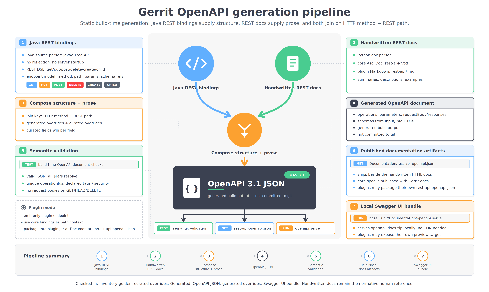

# gerrit_rules_openapi

Build-time Bazel **ruleset** that extracts an OpenAPI 3.1 document from Gerrit's
REST bindings (**source → spec**). Not a Gerrit plugin — nothing here runs at
runtime. Gerrit core and plugins consume it via `bazel_dep`.

## How it works

Java REST bindings supply the structure (operations, parameters, schema refs) and the
handwritten REST docs supply the prose (summaries, descriptions, examples); the two are
composed on the HTTP method + REST path into an OpenAPI 3.1 document at build time, which
a semantic gate then validates. Plugins run the same pipeline over their own bindings.
Nothing is hand-edited — the document is a build output.



## What's here

- `openapi/` — public rule facades (`report.bzl`, `generate.bzl`, `defs.bzl`),
  providers, the extractor toolchain type, and `internal/` implementations.
- `extractor/java/` — the parse-only AST extractor + OpenAPI emitter (runs at JDK 25).
- `extractor/py/` — the prose/overrides miner, composer, and stats (stdlib only).
- `extractor/data/` — curated overrides, schema-required, golden-diff script.
- `examples/smoke/` — byte-equality + determinism tests.

## Use it

The consumer declares the generation pipeline over its own REST source + docs; the
ruleset only carries the tools. `info.version` is passed in — the ruleset never reads
the host Gerrit version.

### Depend on the ruleset

It is not in a Bazel registry yet, so pin it with an override in your `MODULE.bazel`
(the `bazel_dep` version line is required, but the override supplies the real module):

```python
bazel_dep(name = "gerrit_rules_openapi", version = "1.0.0")

# External consumer: pin a commit from GitHub.
git_override(
    module_name = "gerrit_rules_openapi",
    remote = "https://github.com/davido/gerrit_rules_openapi.git",
    commit = "<sha>",
)

# Or, when it is checked out next to your repo (how Gerrit depends on it today):
# local_path_override(
#     module_name = "gerrit_rules_openapi",
#     path = "../gerrit_rules_openapi",
# )
```

### 1. Core

Gerrit core wires the `openapi_endpoint_report` rule directly, once per slice (base,
merged, per-domain) in `//tools/openapi/BUILD.bazel`. The merged document:

```python
load("@gerrit_rules_openapi//openapi:report.bzl", "openapi_endpoint_report")

openapi_endpoint_report(
    name = "openapi_json",                       # merged core document
    out = "all-domain-openapi.generated.json",
    format = "openapi",
    modules = ALL_DOMAIN_MODULES,                # REST binding modules to emit
    roots = ALL_DOMAIN_ROOTS,                    # source roots the extractor parses
    overrides = ":openapi_composed_overrides",   # mined + curated prose
    version = "3.16.0-SNAPSHOT",
    tags = ["manual"],
)
```

```sh
bazel build //tools/openapi:openapi_json                 # merged OpenAPI 3.1 document
bazel build //tools/openapi:openapi_<domain>_json        # per-area slice (access, ...)
bazel test  //tools/openapi:all_domain_openapi_spec_test # semantic gate
bazel test  //tools/openapi:all_domain_golden_test       # REST-surface drift golden
```

### 2. Plugin

A Gerrit plugin (e.g. checks) wires the `openapi_plugin_spec` macro — the whole
base → mine → compose → emit pipeline, plus the semantic gate and an endpoint-inventory
golden test, in one call:

```python
load("@gerrit_rules_openapi//openapi:report.bzl", "openapi_plugin_spec")

openapi_plugin_spec(
    name = "checks_openapi_json",
    plugin = "checks",
    modules = ["com.google.gerrit.plugins.checks.api.ApiModule"],
    roots = [
        ":checks__plugin",
        "//java/com/google/gerrit/server/restapi",
        "//java/com/google/gerrit/httpd",
        "//java/com/google/gerrit/extensions:api",
    ],
    docs = glob(["resources/Documentation/rest-api*.md"]),   # prose mined from here
    context_modules = ["com.google.gerrit.server.restapi.change.ChangeRestApiModule"],
    curated_overrides = "openapi-overrides.json",
    inventory_golden = "testdata/checks-openapi-endpoints.golden.json",
    version = "3.16.0-SNAPSHOT",
)
```

```sh
bazel build //plugins/checks:checks_openapi_json
bazel test  //plugins/checks:checks_openapi_json_spec_test   # semantic gate
```

See [`docs/report.md`](docs/report.md) for every attribute of both.

Core and plugins drive the **same** two entry points above, and everything downstream
flows from their output — one source of truth for the whole ecosystem: the published
[gerrit-openapi](https://github.com/davido/gerrit-openapi) spec distribution, the
per-language [SDKs](https://github.com/davido/gerrit-openapi#generated-sdks) generated
from it, and the in-Gerrit [Swagger-UI viewer](https://github.com/davido/gerrit-openapi-viewer).

## API reference

Generated Starlark API docs (rendered from the rule docstrings with Stardoc;
regenerate with `bazelisk run --config=docs //docs:update_docs`):

- [`openapi_endpoint_report`](docs/report.md) — the low-level rule core's `//tools/openapi` drives (base spec, merged spec, per-domain slices).
- [`openapi_plugin_spec`](docs/report.md) — a plugin's full pipeline in one call.
- [`openapi_resource_jar`](docs/openapi_resource_jar.md) — package a spec into a plugin jar.
- [`openapi_dev_serve`](docs/openapi_dev_serve.md) — serve a local Swagger UI preview of the spec.
- [`core_context_archive`](docs/core_context_archive.md) — deterministic core-context archive.
- [`providers`](docs/providers.md) — `GerritOpenApiSpecInfo`, extractor toolchain info.

## License

Apache-2.0.
